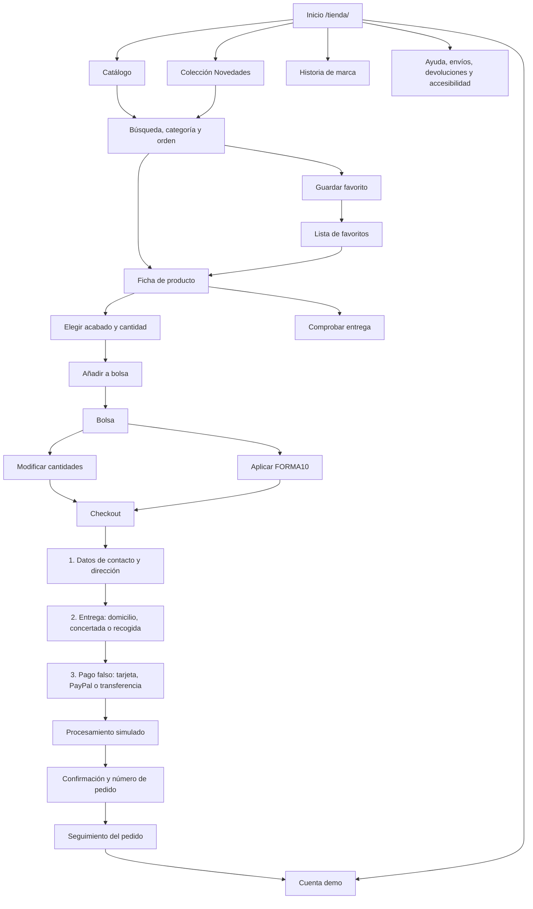

# FORMA — flujo funcional de ecommerce

## Reglas de la demostración

- La bolsa, favoritos y último pedido se guardan únicamente en `localStorage`.
- Ningún formulario transmite información a un servidor.
- La pasarela valida el formulario, simula procesamiento, genera un número de pedido, vacía la bolsa y abre la confirmación.
- La tarjeta `4242 4242 4242 4242`, fecha `12 / 30` y CVC `123` son datos ficticios sugeridos para probar el flujo.
- El cupón demostrativo es `FORMA10`.
